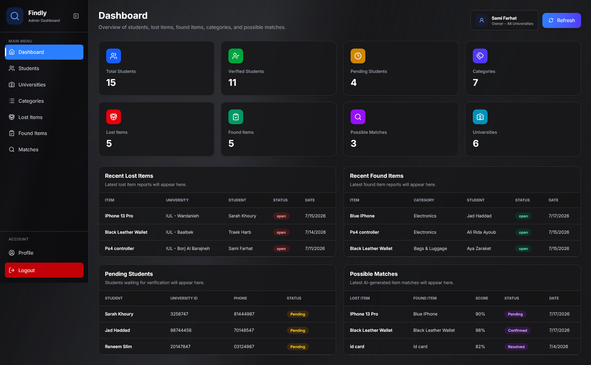
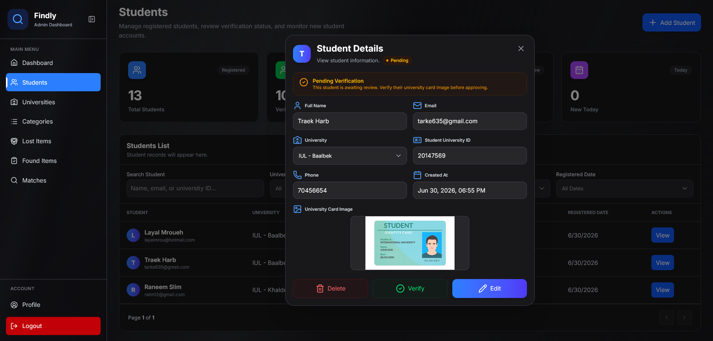
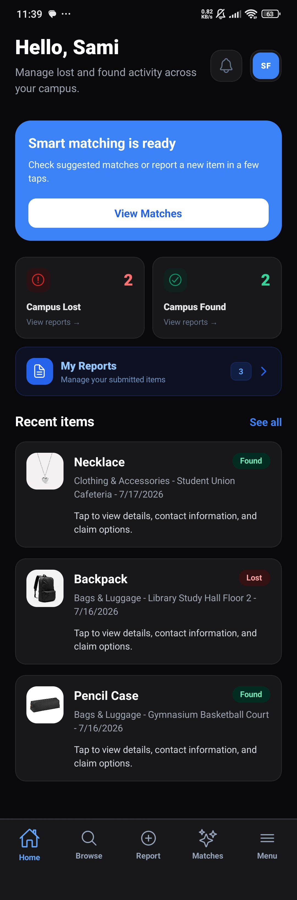
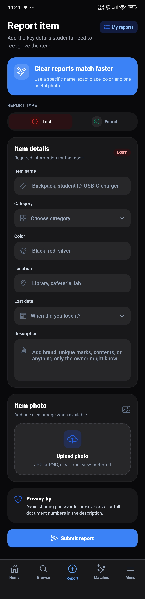
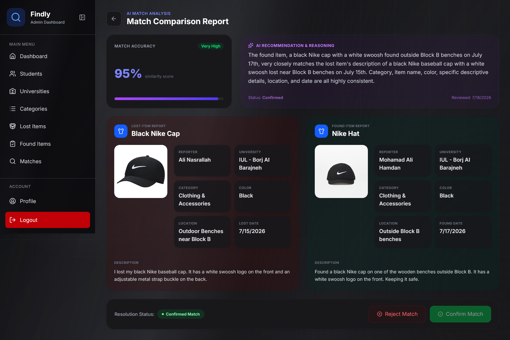
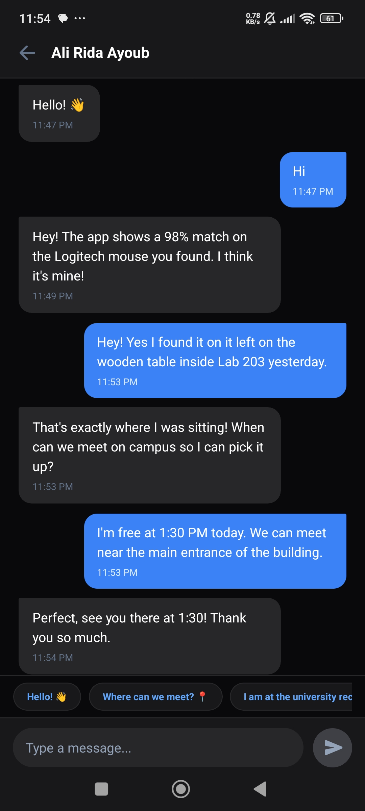

# Findly — AI-Powered Lost & Found System for University Campuses


Findly is a full-stack lost and found platform designed for university campuses. It helps students report lost and found items, uses AI to suggest possible matches, allows admins to review matches, and enables students to communicate safely after a match is confirmed.

The system includes a web admin dashboard, a mobile student application, an ASP.NET Core backend API, PostgreSQL database, Supabase Storage, private in-app chat, n8n workflow automation, and Gemini AI matching.

---

## Project Overview

Traditional lost and found systems inside universities are often manual, scattered, and inefficient. Students may need to check multiple offices, ask in social media groups, or expose their phone numbers publicly.

Findly solves this problem by centralizing lost and found reports and supporting the recovery process through:

- Student registration and verification
- Lost and found item reporting
- Image upload for item identification
- AI-assisted matching
- Admin match review
- Push notifications
- Private realtime chat
- Report resolution after item recovery

---

## Project Status

This project was developed as a final-year computer science graduation project.

The system is complete as a working prototype and includes the main web, mobile, backend, database, AI matching, notification, image storage, authentication, authorization, and realtime chat workflows.

---

## Main Users

| User Role | Description |
|---|---|
| Owner | Has full access to the system and manages universities, admins, categories, students, reports, and matches |
| University Admin | Manages students, reports, and matches for one assigned university branch |
| Student | Uses the mobile app to register, report items, receive matches, chat, and resolve reports |

---

## Tech Stack

### Backend

- ASP.NET Core Web API
- C#
- Entity Framework Core
- PostgreSQL
- JWT Authentication
- BCrypt Password Hashing
- Role-Based Authorization

### Admin Web Dashboard

- React.js
- TypeScript
- Vite
- Axios
- React Router

### Mobile App

- React Native
- Expo
- Expo SecureStore
- Expo ImagePicker
- Expo Push Notifications
- Axios

### Database and Storage

- Supabase PostgreSQL
- Supabase Storage

### AI and Automation

- n8n Workflow Automation
- Gemini AI

---

## Main Features

### Student Features

- Register with university information
- Upload university card image
- Wait for admin verification
- Login after verification
- Report lost items
- Report found items
- Upload item images
- View possible confirmed matches
- Receive notifications
- Chat with the matched student
- Resolve recovered reports

### Admin Features

- Login with JWT authentication
- View dashboard statistics
- Manage students
- Verify or reject student registrations
- Manage lost and found reports
- Review AI-generated matches
- Confirm or reject matches
- Manage categories
- Manage universities and admins according to role

### AI Matching Features

- Backend triggers n8n after item creation
- n8n requests candidate items from backend
- Backend filters candidates before AI
- Gemini compares item details
- Matches with high similarity are saved as pending
- Admin reviews AI suggestions before students are connected

---

## System Architecture

```text
Student Mobile App
      |
      | Axios + JWT
      v
ASP.NET Core Backend API
      |
      | EF Core
      v
Supabase PostgreSQL Database

Admin React Dashboard
      |
      | Axios + JWT
      v
ASP.NET Core Backend API

Image Upload Flow:
Mobile/Web → Supabase Storage → Object link → Backend → Database

Chat Flow:
Backend checks match access → saves message → push notification → chat screen polls the API

AI Matching Flow:
Backend creates item → n8n webhook → Candidate search → Gemini AI → Save pending match → Admin review
```

---

## Main Workflow

```text
Student registers
→ Admin verifies student
→ Student reports lost or found item
→ Image is uploaded to Supabase Storage
→ Backend saves report
→ Backend triggers n8n workflow
→ n8n gets filtered candidates from backend
→ Gemini compares item details
→ Strong matches are saved as Pending
→ Admin confirms or rejects the match
→ Students receive notifications
→ Students chat privately
→ Student resolves the case after item recovery
```

---

## Matching Workflow

The matching process uses two filtering stages.

### Backend Candidate Filtering

Before sending items to AI, the backend filters candidates using:

- Opposite item type
- Same university
- Same category
- Open status
- Different student
- Close date range
- Candidate limit

### n8n and Gemini Filtering

After candidates are retrieved:

- n8n checks if candidates exist
- Gemini compares item name, description, color, location, date, category, and image URL if useful
- n8n keeps only possible matches with similarity score greater than or equal to 70%
- Backend validates the match again before saving it as Pending

---

## Authentication and Authorization

Findly uses JWT authentication.

After login:

```text
Backend verifies credentials
→ Backend generates JWT
→ Frontend stores token
→ Axios sends token in Authorization header
→ Backend validates token using [Authorize]
```

The JWT contains important claims such as:

- User ID
- Email
- Role
- University ID
- Student verification status

Role-based authorization separates access between Owner, University Admin, and Student.

---

## Image Storage

Findly does not store image files directly in PostgreSQL.

Instead:

```text
User selects image
→ Image is uploaded to Supabase Storage
→ The object's link is stored in the database
```

| Image Type | Bucket | Access |
|---|---|---|
| University card image | `universities-cards` | Private. Admins get a 5-minute signed link from `GET /students/{id}/university-card`, only for students they manage |
| Lost item image | `items` | Public |
| Found item image | `items` | Public |

Database stores only URLs such as:

- `UniversityCardImageUrl`
- `ImageUrl`

---

## Chat

Chat becomes available after an admin confirms a match.

Message flow:

```text
Student sends message
→ Backend checks the student belongs to the match and the match is Confirmed or Resolved
→ Backend saves message in Messages table (the receiver is always the other student)
→ Backend creates notification and sends a push notification
→ The other student's open chat screen picks it up on its next poll (every 4 seconds)
```

Messages are only ever read through the API. Supabase Realtime is not used for chat: students do not have Supabase accounts, so Supabase could not limit a subscription to one student's matches.

---

## Security Setup

The anon key ships inside the mobile and admin apps, so anything it can reach is public.

1. **Row level security.** The `EnableRowLevelSecurity` migration turns RLS on for every Findly table with no policies, so the anon key cannot read or write them through Supabase's REST or Realtime APIs. The API is unaffected because it connects as the tables' owner. Apply it with `dotnet ef database update` using the same database user as the API; it refuses to run if that user does not own the tables.
2. **Private ID cards.** Set `Supabase__Url` and `Supabase__ServiceRoleKey` on the API host, deploy, then run [`supabase/private-university-cards.sql`](supabase/private-university-cards.sql) in the Supabase SQL editor. The service-role key bypasses all Supabase security: keep it on the server only, never in an app.
3. **Secrets.** `Jwt:Key`, `N8n:Secret` and the database connection string come from environment variables or user secrets, never from committed files. Use at least 32 random bytes for each secret (`openssl rand -base64 48`).

---

## Notifications

Findly supports two types of notifications:

| Notification Type | Description |
|---|---|
| Database Notification | Saved in the database and shown in the mobile app |
| Expo Push Notification | Sent to the student’s phone through Expo |

Push notification flow:

```text
Student allows notifications
→ Mobile app gets Expo push token
→ Token is sent to backend
→ Backend stores token
→ Match/message event happens
→ Backend sends request to Expo
→ Student receives phone notification
```

---

## Project Structure

```text
Findly
├── backend
│   ├── Controllers
│   ├── Services
│   ├── Models
│   ├── Data
│   ├── Validators
│   └── Migrations
│
├── admin
│   ├── src
│   │   ├── pages
│   │   ├── components
│   │   ├── services
│   │   └── api
│
└── mobile
    ├── src
    │   ├── screens
    │   ├── services
    │   ├── api
    │   ├── navigation
    │   └── storage
```

---

## Screenshots

### Admin Dashboard



### Student Verification



### Mobile Home

<p align="center">
  
</p>

### Report Item Screen

<p align="center">
  
</p>

### Match Review



### Chat Screen

<p align="center">
  
</p>

---

## Demo Video

[Watch the Findly demo video](https://drive.google.com/file/d/1v0SOa4yqmMoDwy0Iu_RnM6rnAb1L9V1M/view?usp=sharing)

---

## Prerequisites

Before running the project locally, make sure you have:

- .NET SDK installed
- Node.js and npm installed
- Expo CLI / Expo Go for mobile testing
- PostgreSQL database or Supabase project
- Supabase Storage configured
- n8n workflow configured
- Gemini API key configured

---

## Setup Instructions

### Backend Setup

```bash
cd backend
dotnet restore
dotnet ef database update
dotnet run
```

Backend runs on:

```text
http://localhost:5192
```

### Admin Setup

```bash
cd admin
npm install
npm run dev
```

### Mobile Setup

```bash
cd mobile
npm install
npx expo start
```

---

## Environment Variables

The project requires local environment configuration for the backend, admin dashboard, and mobile app.

Real secrets are not committed to this repository. Use the example files as templates.

### Backend

Create local backend configuration using `.NET User Secrets` or a local development configuration file.

Required backend values:

```text
ConnectionStrings:SupabaseDb
Jwt:Key
N8n:WebhookUrl
N8n:Secret
Gemini:ApiKey
```

Example file:

```text
backend/appsettings.example.json
```

### Admin Dashboard

Create:

```text
admin/.env
```

Required values:

```env
VITE_SUPABASE_URL=YOUR_SUPABASE_URL
VITE_SUPABASE_ANON_KEY=YOUR_SUPABASE_ANON_KEY
```

### Mobile App

Create:

```text
mobile/.env
```

Required values:

```env
EXPO_PUBLIC_SUPABASE_URL=YOUR_SUPABASE_URL
EXPO_PUBLIC_SUPABASE_ANON_KEY=YOUR_SUPABASE_ANON_KEY
```

Do not commit real secret keys, database passwords, JWT signing keys, Gemini API keys, or n8n secrets.

---

## Security Note

Real secrets, API keys, database passwords, JWT signing keys, n8n secrets, Gemini API keys, and local environment files are not committed to this repository.

The repository includes only safe placeholder configuration files such as:

- `backend/appsettings.example.json`
- `admin/.env.example`
- `mobile/.env.example`

Private values should be stored locally using `.NET User Secrets`, `.env` files, or deployment environment variables.

---

## Future Improvements

- Deploy backend and admin dashboard online
- Add refresh tokens
- Add stronger backend checks for unverified students
- Add stricter message participant validation
- Improve AI matching with weighted scoring
- Add read receipts for chat
- Add advanced notification settings
- Improve image privacy and access rules
- Add analytics dashboard

---

## Author

Sami Farhat  
Computer Science Graduate  
GitHub: [SF-47](https://github.com/SF-47)  
Repository: [Findly](https://github.com/SF-47/findly)  
LinkedIn: [samifarhat-dev](https://www.linkedin.com/in/samifarhat-dev)
